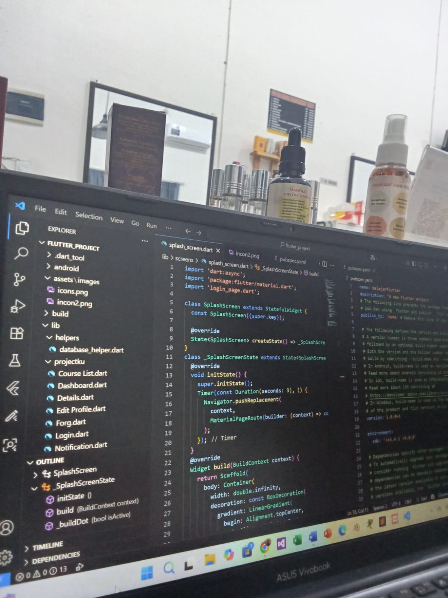

<!-- WELCOME -->

  

 

<!-- WEB DEVELOPMENT WORKFLOW -->

  

<!-- PROFILE BANNER -->

  

---

## 🛠️ TECH STACK

### Programming Languages

- **HTML5**
- **CSS3**
- **JavaScript**
- **PHP**
- **Python**

### Mobile Development

- **Flutter**
- **Dart**

### Database

- **MySQL**
- **MariaDB**

### Operating Systems & Web Servers

- **Linux**
- **Nginx**
- **Apache**
- **WordPress**

### Development & Design Tools

- **Postman**
- **Sublime Text**
- **Canva**
- **Figma**

---

## 👩‍💻 ABOUT ME

### 🌐 Networking & System Administration

- **Cisco Networking**
- **Routing & Switching**
- **MikroTik**
- **Network Administration**
- **Network Configuration**
- **Network Topology**
- **VLAN**
- **Static Routing**
- **Dynamic Routing**
- **TCP/IP**
- **DHCP**
- **DNS**
- **Access Point**
- **Network Troubleshooting**
- **Bandwidth Management**

### Cisco Packet Tracer Projects

  

---

### 💻 Web Development

- **PHP**
- **HTML5**
- **CSS3**
- **JavaScript**
- **MySQL**

---

### 📱 Flutter / Mobile Development

- **Flutter**
- **Dart**
- **Mobile App Development**
- **UI/UX Design**

---

<!-- FOOTER BANNER -->

  

