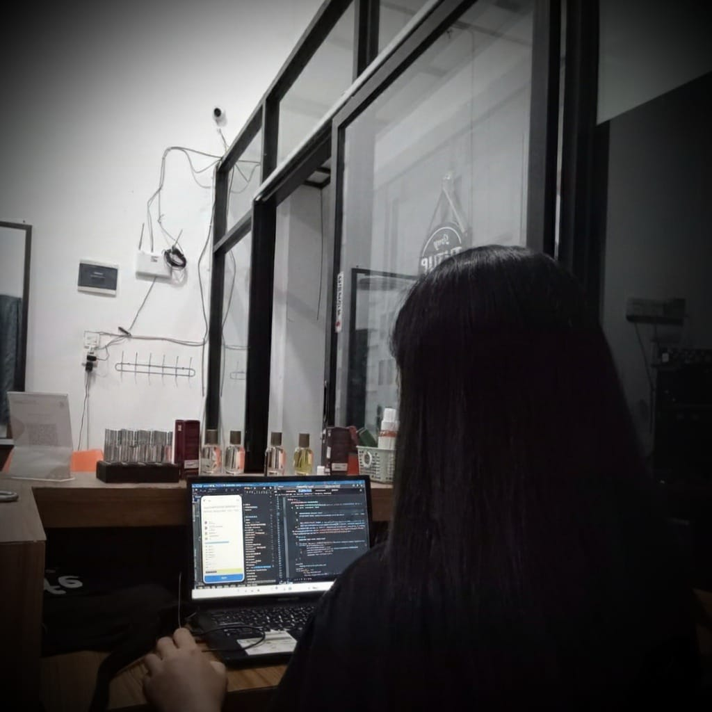
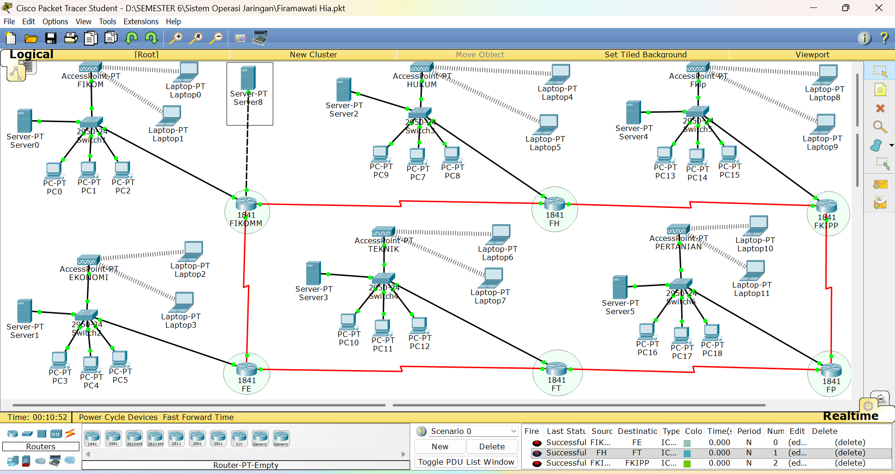
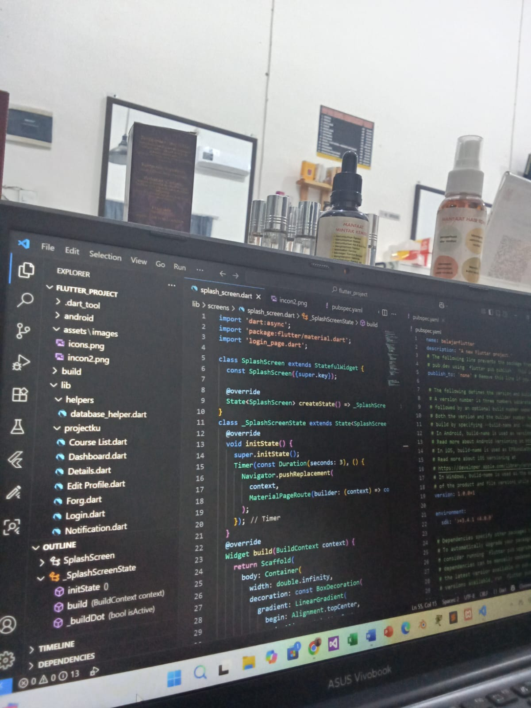

<h2 align="center">👋 Hi, I'm Firamawati Hia</h2>

  

<h3 align="center">🛠 Tech Stack</h3>

  
  
  
  
  
  
  
  
  
  
  
  
  
  
  
  
  

 
<h3>👩‍💻 About Me</h3>

## 🌐 Networking

* Cisco Networking
* Cisco Routing and Switching
* MikroTik
* Network Administration
* Network Configuration
* Network Topology
* VLAN Configuration
* Static Routing
* Dynamic Routing
* TCP/IP
* DHCP
* DNS
* Access Point Configuration
* Network Troubleshooting
* Bandwidth Management

  

 

## 💻 Web Development

* Web Development
* PHP
* HTML
* CSS
* JavaScript
* MySQL

## 📱 Flutter / Mobile Development

* Flutter
* Dart
* Mobile Application Development
* UI/UX Design

 

  

 

<h3 align="center">⌨️ Let's Connect</h3>

  

<h3 align="center">📊 GitHub Stats</h3>

  
  

  

<h3 align="center">📈 Contribution Activity</h3>

  

<h3 align="center">🏆 Achievements</h3>

  

  

  

