<!-- WELCOME MESSAGE -->
<h1 align="center">WELCOME TO MY GITHUB PROFILE!👋 </h1>

  WELCOME TO MY GITHUB PROFILE! I'M FIRA, AND I'M HAPPY TO HAVE YOU VISIT MY PAGE.

  FEEL FREE TO EXPLORE MY PROJECTS, DISCOVER MY WORK,
  AND FOLLOW MY JOURNEY IN THE WORLD OF TECHNOLOGY.

  <b>IS THERE ANYTHING I CAN HELP YOU WITH? LET'S CONNECT AND GROW TOGETHER! 🚀</b>

 

<!-- WEB DEVELOPMENT WORKFLOW -->

  

<!-- PROFILE BANNER -->

  

<!-- TECH STACK -->
<h3 align="center">🛠 Tech Stack</h3>

  
  
  
  
  
  
  
  
  
  
  
  
  
  
  
  
  

 

<!-- ABOUT ME -->
<h3>👩‍💻 About Me</h3>
## 🌐 Networking

* Cisco Networking
* Cisco Routing and Switching
* MikroTik
* Network Administration
* Network Configuration
* Network Topology
* VLAN Configuration
* Static Routing
* Dynamic Routing
* TCP/IP
* DHCP
* DNS
* Access Point Configuration
* Network Troubleshooting
* Bandwidth Management

  

 

## 💻 Web Development

* Web Development
* PHP
* HTML
* CSS
* JavaScript
* MySQL

## 📱 Flutter / Mobile Development

* Flutter
* Dart
* Mobile Application Development
* UI/UX Design

 

<!-- FOOTER BANNER -->

  

