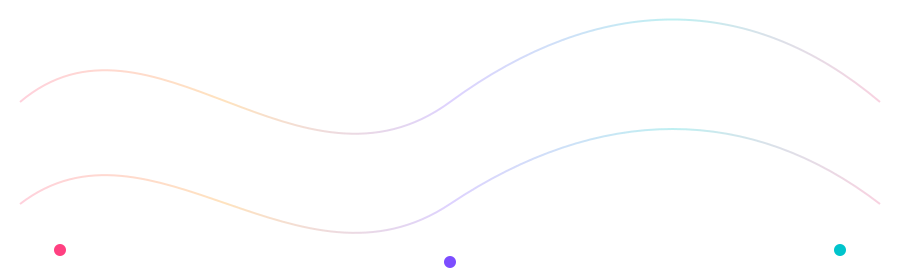

<!-- CURVED WELCOME TEXT -->

  

<!-- TYPING ANIMATION -->

  

 

<!-- WEB DEVELOPMENT WORKFLOW -->

  

<!-- EXPLORE TEXT -->

  

<!-- HELP TEXT -->

  

<!-- PROFILE BANNER -->

  

<!-- TECH STACK -->

  

  
  
  
  
  
  
  
  
  
  
  
  
  
  
  
  

 

<!-- ABOUT ME -->

  

<h3 align="center">🌐 Networking</h3>

  
  
  
  
  
  
  
  
  
  
  
  
  
  
  

  

 

<h3 align="center">💻 Web Development</h3>

  
  
  
  
  

<h3 align="center">📱 Flutter / Mobile Development</h3>

  
  
  
  

 

<!-- FOOTER BANNER -->

  

