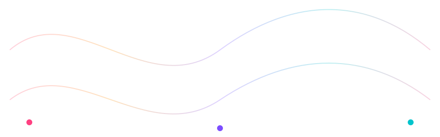
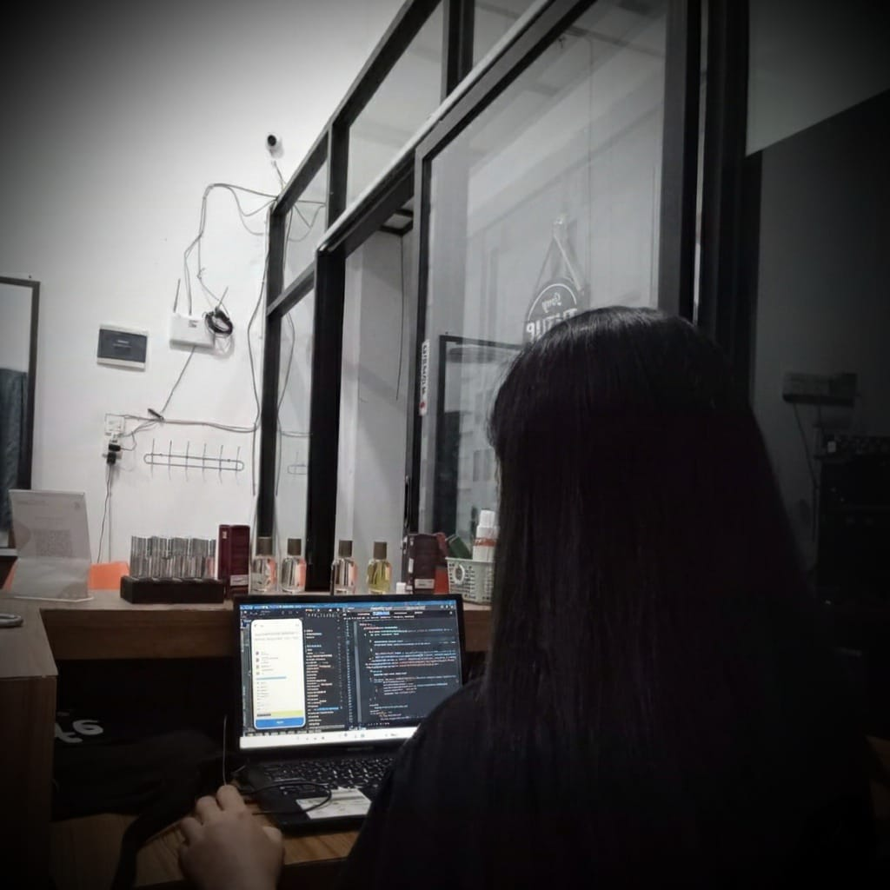
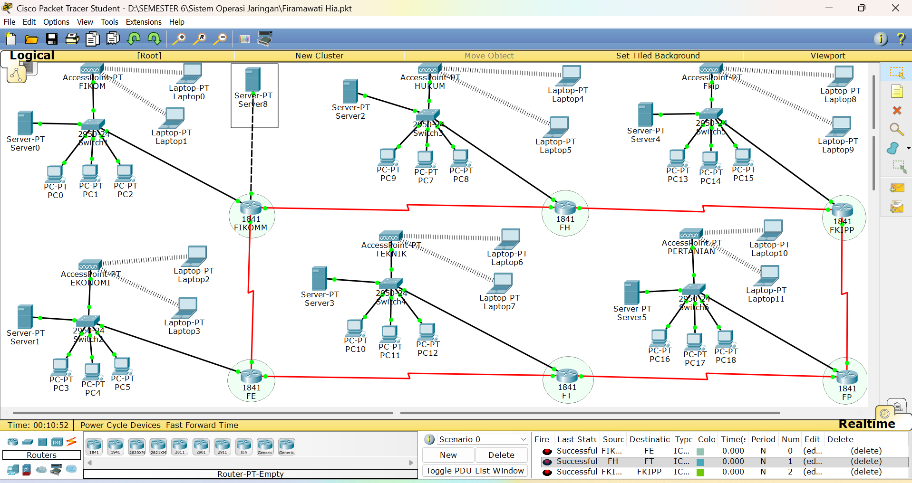

<!-- WELCOME -->

  

 

<!-- WEB DEVELOPMENT WORKFLOW -->

  

<!-- PROFILE BANNER -->

  

---

## 🛠️ Tech Stack

**Programming Languages**

  

  

  

  

  

**Mobile Development**

  

**Database**

  

  

**Operating Systems & Web Servers**

  

  

  

  

**Development & Design Tools**

  

  

  

  

---

## 👩‍💻 About Me

### 🌐 Networking & System Administration

  

  

  

  

  

  

  

  

  

  

  

  

  

  

  

**Cisco Packet Tracer Projects**

  

---

### 💻 Web Development

  

  

  

  

  

---

### 📱 Flutter / Mobile Development

  

  

  

  

---

<!-- FOOTER BANNER -->

  

